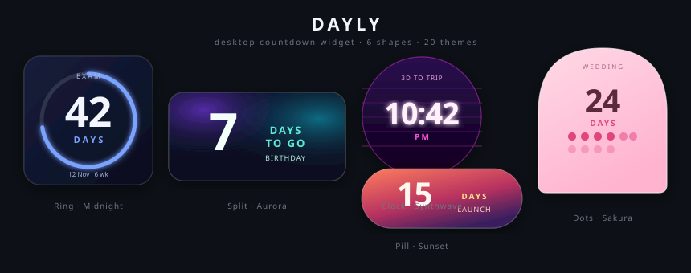

# Dayly

A desktop widget that shows your **countdown** and flips to reveal a **live clock** — tap it to switch between the two. Sits quietly on your desktop, never in your taskbar.

*Click the widget anytime to flip between countdown ↔ clock*

---

## ⬇️ Download for Windows

**[Actions → latest run → Artifacts → `Dayly-installer`](https://github.com/Adi-2903/Dayly/actions)**

Unzip and run the Setup `.exe`. No admin needed.

---

## Controls

| | |
|---|---|
| **Click** | Flip between countdown and clock |
| **Drag** | Move it anywhere |
| **Scroll** | Switch between events |
| **Right-click** | Open settings |
| **Ctrl + scroll** | Resize |
| **Tray icon** | Stick to desktop · Reset position · Quit |

---

## What you can change

**6 Shapes** — Square, Wide, Tall, Circle, Arch, Pill

**12 Countdown styles** — Ring, Dots, Flip cards, Ticket, Stamp, Poster, Bar, D·H·M·S, and more

**5 Clock styles** — Digital, Analog, Flip, Stacked, Rings · supports 12h and 24h

**20 Themes** — Midnight, Aurora, Sakura, Synthwave, Terminal, Sunset, Paper, Ocean, Ember, and more

---

## Stick to desktop

Pins the widget above your icons, below every app — stays visible even on Win+D.
Toggle from the tray icon near the clock.

---

## Built with

**Frontend** — HTML · CSS · Vanilla JS (single file, no framework)

**Backend** — Rust · [Tauri v2](https://tauri.app) · Windows API (`SetWindowRgn`, `SetParent`) for desktop pinning and shape clipping

**Build** — GitHub Actions → NSIS installer

---

*Made by [Aditya Jain](https://github.com/Adi-2903)*
